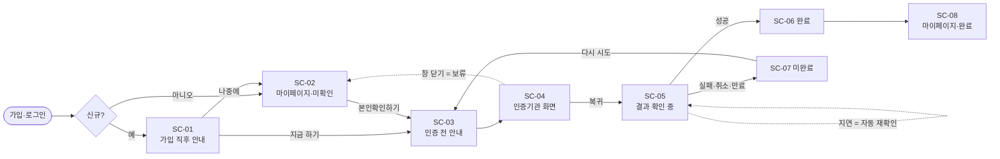
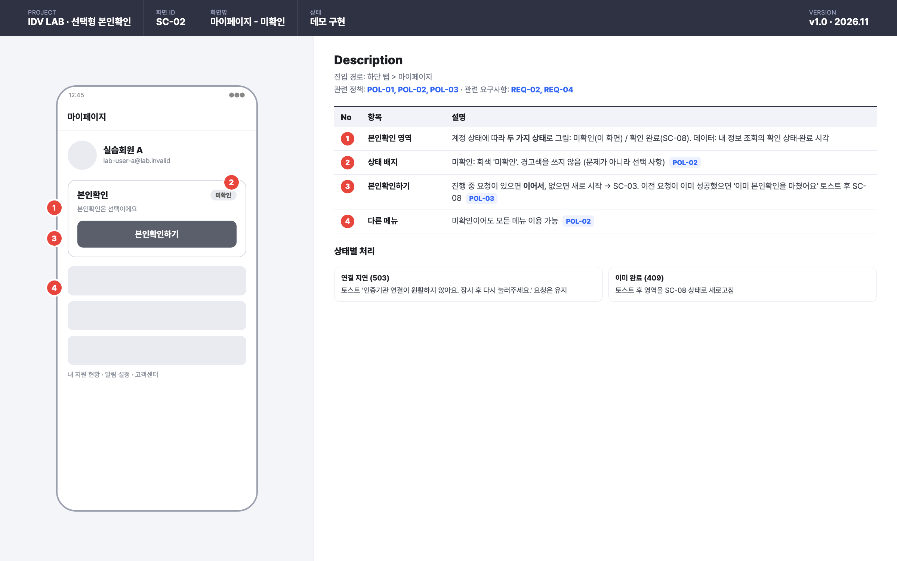
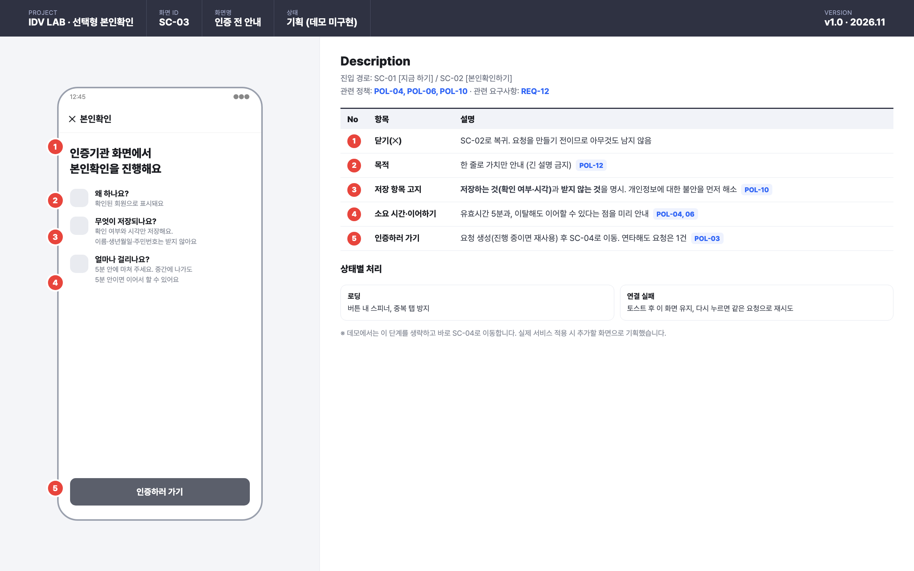
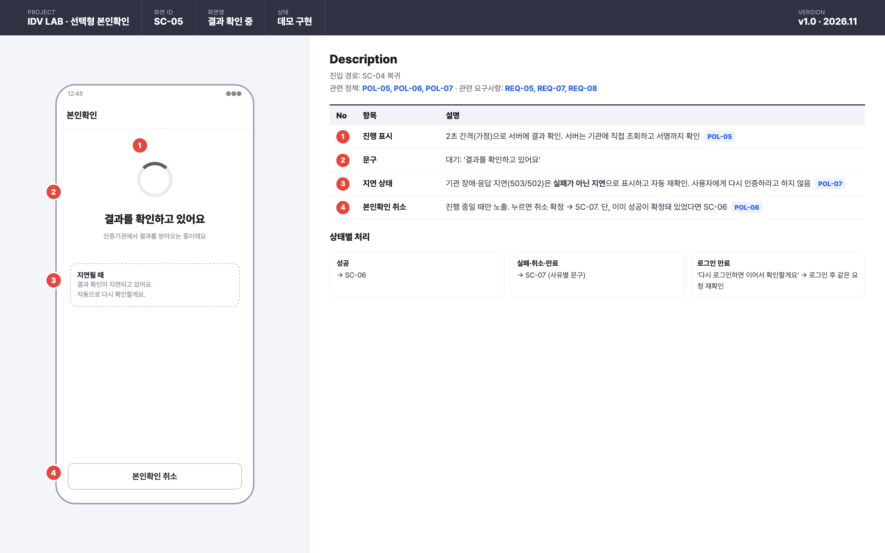

# IDV LAB: 가입 후 선택형 본인확인

**"확인된 사람을, 가입 장벽 없이."**
가입 후 원하는 사용자만 본인확인을 마치고, 그 결과를 계정에 믿을 수 있게 기록하는 기능을 **정책 → 유저 플로우 → 화면설계 → API → 운영**까지 기획하고 동작하는 형태로 검증한 개인 프로젝트입니다.

> **먼저 밝혀 둡니다**
> - **저는 서비스 기획자입니다.** 문제 정의, 정책, 유저 플로우, 화면설계, API·예외 설계, 검증 기준은 직접 정의하고 결정했습니다.
> - **코드 구현은 AI 코딩 에이전트(Claude Code)의 도움을 많이 받았습니다.** 기획한 내용을 실제로 동작하는지 확인하려는 목적이었습니다. AI 결과물은 테스트·E2E·CI로 검증했습니다. 역할 분담은 [AI 협업 방식](docs/50-ax-automation.md)에 있습니다.
> - **실제 본인확인이 아닙니다.** 외부 인증기관은 로컬 모의 서버로 대체했고, 공개된 인증서 API 가이드의 흐름 구조만 참고했습니다([참고 내역](docs/08-public-guide-reference.md)).
> - 출발점은 팀 프로젝트(채용 결과 공유 서비스 *합합*)의 가입·마이페이지 흐름입니다. 이 저장소에는 **팀 코드가 없습니다**([출발점과 범위](docs/01-origin-and-scope.md)).

---

## 1. 문제 정의

| | |
|---|---|
| **상황** | 소셜 로그인만으로 가입하는 서비스는 "이 계정의 주인이 확인된 사람인지" 알 수 없다 |
| **쉬운 해법 ①** | 가입할 때 본인확인을 강제 → 서비스 본질과 무관한 단계가 **가입 이탈**을 만든다 |
| **쉬운 해법 ②** | 앱이 "인증 성공"을 알려주면 기록 → 요청은 위·변조될 수 있어 **누구나 확인 완료**가 된다 |
| **목표** | 가입·로그인은 그대로 두고, **원하는 사용자만 선택적으로** 본인확인을 하게 한다. 결과는 **서버가 인증기관에 직접 확인**한 것만 기록한다 |

→ [기획서(PRD)](docs/10-prd.md) · [요구사항 정의서](docs/11-requirements.md)

## 2. 핵심 정책

| ID | 정책 | 왜 |
|---|---|---|
| POL-01 | 진입점은 **가입 직후 1회 안내**와 **마이페이지 상시** 두 곳 | 관심이 가장 높은 순간에 한 번 권하고, 이후에는 필요할 때 찾게 |
| POL-02 | 미확인이어도 **어떤 기능도 막지 않는다** | 선택형이라는 약속을 지키려면 불이익이 없어야 함 |
| POL-03 | 진행 중 요청은 1건, 다시 누르면 **이어서 진행** | 연타·재실행마다 요청이 쌓이면 어떤 결과가 최종인지 알 수 없음 |
| POL-05 | 결과는 **서버가 직접 확인하고 전자서명까지 검증**한 것만 인정 | 앱이 보낸 '성공'은 위·변조 가능 |
| POL-06 | **'취소' 버튼만 취소**, 화면을 닫으면 보류 | 실수로 닫은 사용자에게 처음부터 다시 하게 하지 않음 |
| POL-07 | 확인 지연은 **실패가 아니라 '지연'** | 이미 인증을 마친 사용자를 실패로 안내하면 재인증·불신을 낳음 |
| POL-10 | 저장하는 것은 **확인 여부와 시각뿐**, 프로필을 덮어쓰지 않음 | 목적에 필요한 최소한만 처리 |

→ [정책 정의서 (POL-01~12)](docs/12-policy-definition.md) · [상태·예외 상세 (예외 17개)](docs/03-policy-and-exceptions.md)

## 3. 유저 플로우



→ [유저 플로우 (분기·시나리오 A~F)](docs/13-user-flow.md)

## 4. 화면설계

| SC-02 마이페이지·미확인 | SC-03 인증 전 안내 | SC-05 결과 확인 중 |
|---|---|---|
|  |  |  |

→ [화면설계서 (8개 화면 · Description · 응답별 화면 매핑)](docs/14-screen-spec.md)

## 5. API와 연동 설계

- **앱 ↔ 서버** API 3개: 요청 생성(진행 중이면 이어하기), 상태 조회(서버가 기관에 직접 확인), 취소. 그리고 내 정보 응답에 확인 상태 필드를 추가했습니다.
- **서버 ↔ 인증기관(모의)**: 접근토큰 → 요청 등록 → 결과 조회(polling) 구조입니다. 결과코드, 멱등 키, 결과 전자서명을 포함합니다.
- 결과 확인을 별도 API로 나누지 않고 **상태 조회에 포함**했습니다. 앱이 결과를 서버에 보낼 경로 자체를 없애기 위해서입니다([ADR-02](docs/15-decision-log.md)).

→ [API 명세](docs/04-api-spec.md) · [제휴사 연동 규격서](docs/20-partner-integration-guide.md) · [제휴사 포털 기획](docs/21-partner-portal-plan.md)

## 6. 운영·보안·컴플라이언스

- **운영:** API 운영 매뉴얼에 설정표, 감사 로그, 지표 SQL 6종, 장애 런북 A~F를 담았습니다.
- **보안:** 결과 전자서명을 7단계로 검증합니다(실습용 PKI). 위·변조된 결과와 신뢰할 수 없는 서명자를 차단합니다.
- **컴플라이언스:** 정보통신망법, 개인정보보호법, 전자서명법을 설계 결정과 연결하고, 실제 도입 시 빈 곳(갭) 8개를 정리했습니다(학습용 분석).

→ [운영 매뉴얼](docs/30-api-operations-manual.md) · [PKI](docs/41-pki.md) · [컴플라이언스](docs/40-compliance-analysis.md) · [라이선스 심사 점검표](docs/42-license-audit-readiness.md)

## 7. 검증

기획한 정책이 실제로 지켜지는지를 테스트로 확인했습니다.

| 구분 | 결과 |
|---|---|
| 실제 HTTP E2E | **52/52 통과**. 시나리오 8개: 성공·중복 요청, 취소·실패·만료, 다른 회원 차단, 장애·응답 유실 복구, 상태 역전 방지, 재로그인·탈퇴, 동시 클릭, 위·변조 |
| JUnit | 35개 통과 |
| 문서-코드 일치 | 자동 점검 불일치 0건 |
| CI | GitHub Actions에서 위 항목 자동 실행 |

→ [요구사항 ↔ 테스트 대응표](docs/07-traceability-and-tests.md) · [AI 협업과 자동화](docs/50-ax-automation.md)

---

## 직접 실행해 보기

필요한 것: Java 21, PostgreSQL 16(기본 포트 5434), Python 3, openssl. 자세한 내용은 [실행 가이드](docs/06-run-and-verify.md)를 보세요.

```bash
./lab/run-lab.sh
```

실행 후 접속:
- 데모 화면: http://localhost:8080/lab/identity-demo
- Swagger: http://localhost:8080/swagger-ui/index.html
- 제휴사 포털(모의 기관): http://localhost:18090/mock-idp/portal

```bash
./lab/run-lab.sh --e2e
```

## 문서 지도

| 구분 | 문서 |
|---|---|
| **기획** | [기획서(PRD)](docs/10-prd.md) · [요구사항 정의서](docs/11-requirements.md) · [정책 정의서](docs/12-policy-definition.md) · [유저 플로우](docs/13-user-flow.md) · [화면설계서](docs/14-screen-spec.md) · [의사결정 기록](docs/15-decision-log.md) |
| **설계 상세** | [상태·예외](docs/03-policy-and-exceptions.md) · [시스템 흐름도](docs/02-flows.md) · [API 명세](docs/04-api-spec.md) · [데이터 모델](docs/05-data-changes.md) |
| **제휴·운영** | [제휴사 연동 규격서](docs/20-partner-integration-guide.md) · [제휴사 포털 기획](docs/21-partner-portal-plan.md) · [API 운영 매뉴얼](docs/30-api-operations-manual.md) · [실행 가이드](docs/06-run-and-verify.md) |
| **보안·컴플라이언스** | [컴플라이언스 검토](docs/40-compliance-analysis.md) · [PKI](docs/41-pki.md) · [라이선스 심사 점검표](docs/42-license-audit-readiness.md) · [공개 가이드 참고 내역](docs/08-public-guide-reference.md) |
| **검증·AX** | [요구사항↔테스트](docs/07-traceability-and-tests.md) · [AI 협업과 자동화](docs/50-ax-automation.md) · [출발점과 범위](docs/01-origin-and-scope.md) |

<details>
<summary>기술 스택</summary>

Java 21 · Spring Boot 3.5 (Web, Security, Data JPA, WebClient) · PostgreSQL 16 · Flyway · jjwt · springdoc-openapi · Python 3 표준 라이브러리(모의 기관, E2E, 도구) · openssl · GitHub Actions
</details>
