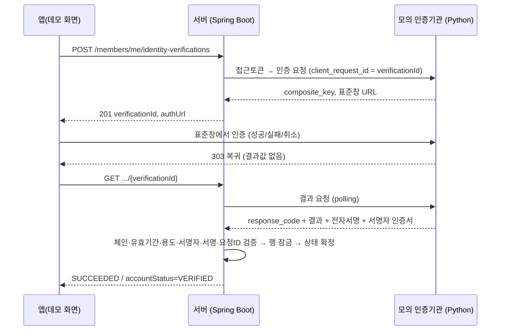

# Identity Verification Lab

**가입 후 선택형 본인확인**을 처음부터 끝까지 설계·구현·검증한 개인 학습 프로젝트입니다. 범위는 기획, API, 운영, PKI, 컴플라이언스입니다.

> **실제 본인확인이 아닙니다.** 외부 인증기관은 로컬 **모의 서버**로 대체했습니다.
> - 실제 본인확인기관 연동이나 카카오뱅크 인증서 연동은 구현하지 않았습니다.
> - 기관 API의 흐름 구조는 [카카오뱅크 인증서 공개 개발 가이드](https://auth.kakaobank.com)를 참고했습니다. 카카오뱅크 API는 호출하지 않았고, 브랜딩도 쓰지 않았습니다.
> - 출발점은 팀 프로젝트(채용 결과 공유 서비스 *합합*)의 가입·마이페이지 흐름입니다. 이 저장소에는 **팀 코드가 없고 본인이 작성한 코드만** 있습니다 ([출발점과 범위](docs/01-origin-and-scope.md)).

## 무엇을 해결하나

소셜 로그인만으로는 "확인된 사람인지"를 알 수 없습니다. 그렇다고 가입할 때 본인확인을 강제하면 이탈이 늘어납니다. 그래서 다음 조건을 만족하도록 설계했습니다.

- 가입·로그인은 그대로 두고, 원하는 사용자만 **선택적으로** 본인확인을 합니다.
- **서버가 외부 기관의 결과를 직접 조회하고, 그 결과의 전자서명까지 검증**한 뒤에만 계정에 "확인 완료"를 기록합니다.
- 실패, 취소, 만료, 외부 장애, 동시 요청, 탈퇴가 겹쳐도 계정 상태가 틀어지지 않습니다.



## 핵심 설계

| 주제 | 결정 | 문서 |
|---|---|---|
| 상태 모델 | 계정 상태(UNVERIFIED/VERIFIED)와 시도 상태(PENDING→SUCCEEDED/FAILED/CANCELLED/EXPIRED)를 분리. 종료 상태는 다시 바뀌지 않음 | [정책](docs/03-policy-and-exceptions.md) |
| 신뢰 | 클라이언트가 보낸 결과는 사용하지 않음. 서버 간 조회 결과와 **전자서명 검증(PKI)**만 신뢰 | [PKI](docs/41-pki.md) |
| 장애 | 네트워크 오류는 실패로 처리하지 않음. 503을 주고 상태를 유지하며, 재조회로 복구 | [ADR-03](docs/12-decision-log.md) |
| 중복 | 회원당 진행 중 요청 1건. DB 부분 유니크 인덱스로 최종 보장 | [ADR-05](docs/12-decision-log.md) |
| 충돌 | 사용자 행동은 외부 기관 기준, 유효시간·확정 상태·계정은 서비스 기준 | [판단 기준](docs/03-policy-and-exceptions.md#33-판단-기준-모의-기관과-서비스-상태가-충돌할-때) |
| 개인정보 | CI·DI·주민등록번호·실명을 수집하지 않음. 로그에도 개인정보 없음 | [컴플라이언스](docs/40-compliance-analysis.md) |

## 빠른 실행

필요한 것: Java 21, PostgreSQL 16(기본 포트 5434), Python 3, openssl. 자세한 내용은 [실행 가이드](docs/06-run-and-verify.md)에 있습니다.

```bash
./lab/run-lab.sh --e2e
```

```bash
./lab/run-lab.sh
```

두 번째 명령으로 서버를 띄운 뒤 아래 주소에 접속합니다.
- Swagger: http://localhost:8080/swagger-ui/index.html
- 데모 화면: http://localhost:8080/lab/identity-demo
- 제휴사 포털(모의 기관): http://localhost:18090/mock-idp/portal

## 검증

| 구분 | 결과 |
|---|---|
| JUnit | 35개 통과 (상태 규칙, 서명 검증 7종, 만료·장애·동시 처리, 인증 기반) |
| E2E (실제 HTTP) | 52/52 통과. 시나리오 8개: 성공·중복, 취소·실패·만료, 다른 회원 차단, 장애·응답 유실 복구, 상태 역전 방지, 재로그인·탈퇴, 동시 클릭, 위·변조·서명자 검증 |
| 문서-코드 일치 | `lab/tools/check_docs.py` 불일치 0건 |
| CI | GitHub Actions에서 문서 점검, JUnit, E2E 자동 실행 (첫 실행에서 Linux 시계 정밀도 버그를 잡음) |

## 문서

| 구분 | 문서 |
|---|---|
| 기획 | [기획서(PRD)](docs/10-prd.md) · [화면·문구](docs/11-screens-and-copy.md) · [의사결정 기록](docs/12-decision-log.md) · [흐름도](docs/02-flows.md) · [정책·예외](docs/03-policy-and-exceptions.md) |
| API | [앱↔서버 API 명세](docs/04-api-spec.md) · [기관 연동 규격서](docs/20-partner-integration-guide.md) · [데이터 모델](docs/05-data-changes.md) |
| 운영 | [API 운영 매뉴얼](docs/30-api-operations-manual.md) · [제휴사 포털 기획](docs/21-partner-portal-plan.md) · [실행 가이드](docs/06-run-and-verify.md) |
| 보안·컴플라이언스 | [컴플라이언스 검토](docs/40-compliance-analysis.md) · [PKI](docs/41-pki.md) · [라이선스 심사 점검표](docs/42-license-audit-readiness.md) · [공개 가이드 참고 내역](docs/08-kakaobank-guide-reference.md) |
| 검증·AX | [요구사항↔테스트](docs/07-traceability-and-tests.md) · [AI 협업과 자동화](docs/50-ax-automation.md) |
| 기타 | [출발점과 범위](docs/01-origin-and-scope.md) · [역량 매핑](docs/00-job-fit.md) |

## 구조

```
src/main/java/idvlab   common · auth · member · verification · lab
lab/                   mock-identity-provider · pki · e2e · ops · tools · run-lab.sh
docs/                  기획 · API · 운영 · 컴플라이언스 · 검증 문서
```

## 기술 스택

Java 21 · Spring Boot 3.5 (Web, Security, Data JPA, WebClient) · PostgreSQL 16 · Flyway · jjwt · springdoc-openapi · Python 3 표준 라이브러리(모의 기관, E2E, 도구) · openssl
