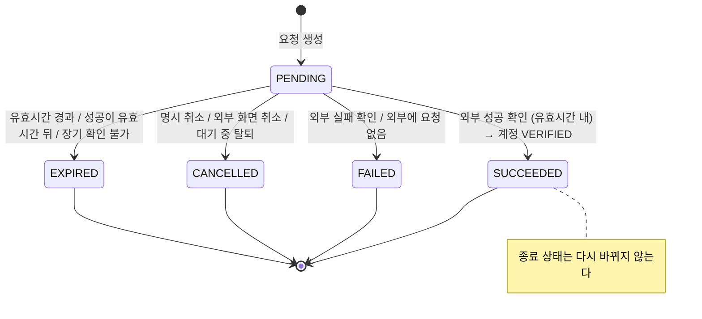

# 3. 기능 정책과 예외 처리

## 3.1 상태 두 가지를 분리한 이유

| 구분 | 값 | 저장 위치 | 의미 |
|---|---|---|---|
| **계정 상태** | `UNVERIFIED`, `VERIFIED` | `members.identity_verification_status`, `identity_verified_at` | 이 계정이 본인확인을 마쳤는지 |
| **시도 상태** | `PENDING`, `SUCCEEDED`, `FAILED`, `CANCELLED`, `EXPIRED` | `identity_verifications.status` | 본인확인 버튼을 누를 때마다 생기는 시도 1건의 진행 상황 |

시도가 실패·취소·만료돼도 계정에는 아무 일도 일어나지 않습니다. 계정이 `VERIFIED`로 바뀌는 경로는 **시도 1건이 `SUCCEEDED`로 확정될 때** 하나뿐입니다.

## 3.2 기능 정책

| 정책 | 내용 | 코드 위치 |
|---|---|---|
| 선택형 | 미확인이어도 다른 API를 모두 쓸 수 있다. 본인확인 여부로 막는 API는 없다 | `SecurityConfig` (본인확인 상태 조건 없음) |
| 로그인 영향 없음 | 로그인 응답에는 본인확인 정보를 넣지 않는다. 로그인할 때마다 다시 확인하지 않는다 | `AuthResponse` (본인확인 필드 없음) |
| 상태 확인 위치 | 계정 상태는 `GET /members/me`로 확인한다 | `MemberResponse#from` |
| 회원 식별 | 로그인 토큰의 userId만 사용한다. Body나 Path로 userId를 받지 않는다 | `@AuthenticationPrincipal Long userId` |
| 결과 신뢰 | 클라이언트가 보낸 값으로 성공 처리하지 않는다. 서버가 외부에 직접 물어본 결과만 반영한다 | `IdentityVerificationService#sync` |
| 프로필 보호 | 본인확인 결과로 이름·이메일·전화번호를 덮어쓰지 않는다(외부에서 그런 값을 받지도 않는다) | `IdentityVerificationTxService#applySuccess` |
| 식별정보 미수집 | CI·DI·주민등록번호를 수집하지 않는다. 계정 병합이나 중복 가입 차단은 구현하지 않는다 | `V1` 스키마에 해당 컬럼 없음 |
| 진행 중 1건 | 회원당 PENDING 시도는 최대 1건이다(DB 부분 유니크 인덱스) | `uk_identity_verifications_user_pending` |
| 실습 환경 한정 | DB와 외부 기관 주소가 localhost가 아니면 기동하지 않는다 (실제 기관이나 운영 DB 호출 방지) | `LabEnvironmentGuard` |

## 3.3 판단 기준: 모의 기관과 서비스 상태가 충돌할 때

| 무엇에 대한 판단인가 | 기준 | 이유 |
|---|---|---|
| 사용자가 외부 화면에서 **무엇을 했는지**(성공·실패·취소) | **외부 기관** | 사용자 행동은 외부 화면에서 일어나고, 서비스는 결과를 조회로만 알 수 있음 |
| **유효시간**(언제까지 인정할지) | **서비스** | 서비스 정책이다. 외부 성공 시각이 서비스 `expiresAt`보다 늦으면 인정하지 않음 |
| **이미 확정된 종료 상태** | **서비스** | 한번 확정되면 외부가 뒤늦게 다른 값을 줘도 바꾸지 않음(상태 역전 금지) |
| **계정 상태**(VERIFIED) | **서비스** | 탈퇴한 회원이면 외부 성공이 와도 반영하지 않음 |
| 서비스 화면에서 명시적으로 취소했는데 외부에 연결되지 않을 때 | **서비스** | 사용자 의사를 존중해 CANCELLED로 확정. 이후 외부 성공은 무시(안전한 방향 = 미확인 유지) |
| 취소 요청을 보냈는데 외부에서는 이미 성공이 확정돼 있을 때 | **외부 기관** | 취소보다 먼저 일어난 성공이므로 SUCCEEDED 반영 |

## 3.4 예외 처리표

| # | 상황 | 처리 | 응답·화면 | 검증 |
|---|---|---|---|---|
| 1 | 버튼 연속 클릭 / 동시 요청 | 기존 PENDING을 재사용한다. 동시에 INSERT되면 DB 부분 유니크 위반이 나고, 이를 잡아 기존 요청을 다시 조회한다 | 첫 요청 201, 나머지 200 `RESUMED`, verificationId 1개 | E2E S1·S7 |
| 2 | 외부 등록은 됐는데 응답이 유실됨 | 시도는 PENDING(외부 ID 없음)으로 남는다. 다시 누르면 같은 `client_request_id`로 재등록하고, 외부 기관이 멱등으로 같은 트랜잭션을 돌려준다 | 첫 시도 503, 재시도 200 + authUrl | E2E S4 |
| 3 | 같은 회원에게 진행 중 요청이 이미 있음 | 외부와 상태를 맞춘 뒤, 아직 진행 중이면 그 요청을 반환한다 | 200 `RESUMED` | E2E S1·S2 |
| 4 | 다른 회원의 요청을 조회·취소 | `verificationId + userId`로 조회하므로 찾을 수 없다. 존재 여부를 숨기려고 403이 아닌 404를 쓴다 | 404 `IDENTITY_VERIFICATION_NOT_FOUND` | E2E S3, JUnit |
| 5 | 명시 취소 vs 화면 닫기 | 명시 취소만 `/cancel`을 호출한다. 화면을 닫으면 아무것도 호출하지 않고 요청은 유효시간까지 PENDING이다(돌아오면 이어서 진행) | 취소 200 CANCELLED / 닫기 후 재진입 시 200 RESUMED | E2E S2 |
| 6 | 인증 유효시간 만료 | 외부가 만료를 알려 오면 EXPIRED(`PROVIDER_EXPIRED`). 외부는 아직 대기인데 서비스 유효시간이 지나면 EXPIRED(`EXPIRED_BEFORE_COMPLETION`)로 두고 외부 요청도 취소 처리한다 | 200 EXPIRED, 계정 미확인 | E2E S2, JUnit |
| 7 | 외부 서버 연결 실패·시간 초과 | 실패로 단정하지 않는다. 상태는 그대로 두고 503을 응답한다. 유효시간 + 유예시간(10분)이 지나도록 확인되지 않을 때만 EXPIRED(`UNCONFIRMED_AFTER_EXPIRY`) | 503 → 재조회로 복구 | E2E S4, JUnit |
| 8 | 성공 후 원래 화면으로 돌아오지 못함 | 결과는 외부에 남아 있다. 데모 화면은 sessionStorage의 verificationId로 다시 조회한다. 그 값도 잃었다면 '본인확인하기'를 다시 눌렀을 때 생성 API가 기존 PENDING을 동기화하고, 성공이 반영되면 409를 응답한다 | 409 → 내 정보 새로고침 → 완료 표시 | JUnit `successWithoutReturnIsRecoveredOnNextStart` |
| 9 | 결과를 반복 조회 | 종료된 시도는 외부를 다시 호출하지 않는다. `markIdentityVerified`는 이미 VERIFIED면 아무것도 하지 않는다 | 완료 시각 불변 | E2E S1, JUnit |
| 10 | 성공·취소·만료가 동시에 도착 | 모든 종료 처리는 시도 행 잠금(`SELECT … FOR UPDATE`) 후 "아직 PENDING인가?"를 다시 확인한다. 먼저 잠금을 잡은 쪽 하나만 반영된다 | 종료 상태 1개, 계정 반영 1회 | JUnit `concurrentFinalization` |
| 11 | 세션 만료 후 같은 회원으로 재로그인 | 요청 소유자는 userId 기준이다. 새 토큰으로도 같은 요청을 조회·재사용할 수 있다 | 200 | E2E S6 |
| 12 | 인증 대기 중 회원 탈퇴 | 탈퇴 트랜잭션 안에서 `IdentityVerificationWithdrawalCleaner`가 PENDING을 CANCELLED(`MEMBER_WITHDRAWN`)로 확정한다. 성공 반영 시점에도 회원이 활성 상태인지 다시 확인한다. 탈퇴할 때 계정 본인확인 상태도 초기화한다 | 이후 외부 성공은 반영 안 됨 | E2E S6, JUnit |
| 13 | 이미 확인 완료된 회원이 추가 요청 | 새 시도를 만들지 않는다 | 409 `IDENTITY_ALREADY_VERIFIED` | E2E S1 |
| 14 | 종료된 요청이 뒤늦게 다른 상태로 | `IdentityVerification#finish`는 PENDING일 때만 동작한다. 외부가 상태를 뒤집어도 무시한다 | 기존 상태 유지 | E2E S2·S5, 단위 테스트 |
| 15 | 외부 접근토큰 만료 | `MV9102`를 받으면 토큰을 1회 재발급하고 다시 시도한다 | 사용자에게 보이지 않음 | 코드(`MockIdentityProviderClient#callWithToken`). **자동 테스트 없음** |
| 16 | 외부 결과가 위·변조됐거나 신뢰할 수 없는 서명자가 서명 | 서명·인증서 체인·유효기간·용도·서명자·요청 ID를 검증하고, 실패하면 반영하지 않습니다. 503과 같은 '미확정'으로 다루고 `INTEGRITY_FAILURE` 감사 로그를 남깁니다 | 502 `IDENTITY_RESULT_INTEGRITY_FAILED`, 상태 유지 | E2E S8, 단위 테스트 `ResultSignatureVerifierTest` 7개 |
| 17 | 등록되지 않은 callback URL로 요청 | 모의 기관이 `MV9107`로 거부합니다(결과 화면 가로채기 방지). 서비스에는 설정 오류로 503이 보입니다 | 503 + 운영 매뉴얼 런북 B | E2E S8 |

## 3.5 숫자 정책 (모두 실습용 가정, 설정값)

실제 인증기관의 정책이 아닙니다. `src/main/resources/application.yml`에서 바꿀 수 있습니다.

| 항목 | 값 | 설정 키 |
|---|---|---|
| 인증 시도 유효시간(서비스) | 5분 | `lab.identity-verification.attempt-ttl` |
| 결과 조회 권장 간격 | 2초 | `lab.identity-verification.poll-interval` |
| 만료 후 미확인 유예 | 10분 | `lab.identity-verification.unconfirmed-grace` |
| 외부 연결 타임아웃 / 응답 타임아웃 | 2초 / 3초 | `lab.mock-identity-provider.connect-timeout` / `response-timeout` |
| 모의 기관 인증 유효시간 | 300초 | 환경변수 `MOCK_IDP_TTL_SECONDS` |
| 모의 기관 접근토큰 유효시간 | 3600초 | 환경변수 `MOCK_IDP_TOKEN_TTL_SECONDS` |

## 3.6 종료 사유 코드 (`endReason`)

| 코드 | 상태 | 뜻 |
|---|---|---|
| `USER_CANCELLED` | CANCELLED | 서비스 화면에서 취소했고 외부에서도 취소를 확인함 |
| `USER_CANCELLED_PROVIDER_UNCONFIRMED` | CANCELLED | 서비스 화면에서 취소했지만 외부 연결 실패로 외부 쪽 취소는 확인하지 못함 |
| `MEMBER_WITHDRAWN` | CANCELLED | 인증 대기 중 탈퇴 |
| `PROVIDER_USER_CANCELLED` | CANCELLED | 모의 인증 화면에서 사용자가 취소 |
| `PROVIDER_REJECTED` | FAILED | 외부가 인증 실패로 판정(모의 시나리오: 정보 불일치) |
| `PROVIDER_TRANSACTION_NOT_FOUND` | FAILED | 외부에 해당 요청이 없음(예: 모의 서버 재시작) |
| `PROVIDER_EXPIRED` | EXPIRED | 외부 유효시간 경과 |
| `EXPIRED_BEFORE_COMPLETION` | EXPIRED | 서비스 유효시간까지 외부에서 완료되지 않음 |
| `SUCCEEDED_AFTER_EXPIRY` | EXPIRED | 외부 성공 시각이 서비스 유효시간 이후 |
| `UNCONFIRMED_AFTER_EXPIRY` | EXPIRED | 유효시간 + 유예시간이 지나도록 외부 결과를 확인할 수 없음 |
| `REGISTRATION_UNCONFIRMED` | EXPIRED | 외부 등록 응답을 받지 못한 채 유효시간 경과 |
