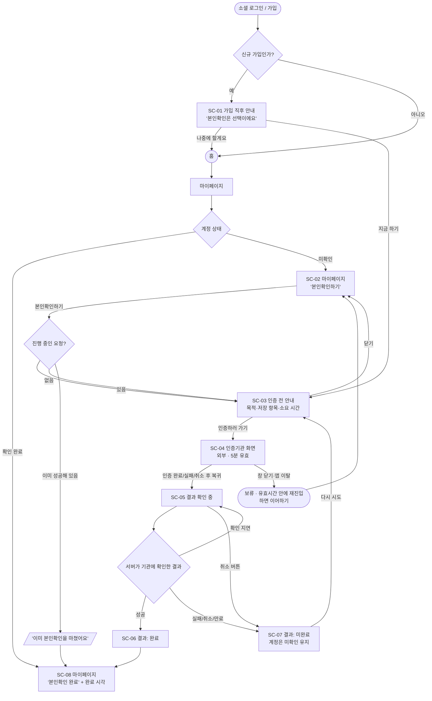
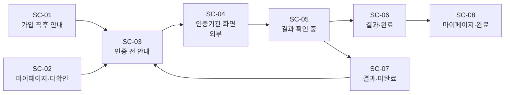

# 13. 유저 플로우

> 사용자가 어떤 순서로 어떤 판단을 내리는지 정리한 문서입니다. 화면 ID(`SC-xx`)는 [화면설계서](14-screen-spec.md)를, 정책 ID(`POL-xx`)는 [정책 정의서](12-policy-definition.md)를 따릅니다.
> 서버와 인증기관 사이의 시스템 시퀀스는 [02 흐름도](02-flows.md)에 있습니다.

## 1. 전체 유저 플로우



## 2. 핵심 분기와 결정

| 분기 지점 | 조건 | 사용자에게 보이는 것 | 정책 |
|---|---|---|---|
| 가입 직후 | 신규 가입일 때만 | 안내 바텀시트 1회. '나중에'를 누르면 다시 띄우지 않음 | POL-01 |
| 본인확인하기 클릭 | 진행 중인 요청이 있음 | 새로 만들지 않고 **이어서** 인증 화면으로 | POL-03 |
| 〃 | 이전 요청이 앱 밖에서 이미 성공 | "이미 본인확인을 마쳤어요" → 완료 화면 | POL-03, 08 |
| 인증 화면 이탈 | 창 닫기, 앱 종료 | 아무것도 바뀌지 않음(보류). 5분 안에 오면 이어하기 | POL-06 |
| 결과 확인 | 기관이 결과를 아직 안 줌 | "인증을 기다리는 중" + 2초 간격 자동 확인 | POL-05 |
| 〃 | 기관 응답 지연·장애 | "결과 확인이 지연되고 있어요" (실패 아님) + 자동 재확인 | POL-07 |
| 〃 | 실패·취소·만료 | "계정은 미확인 상태로 유지돼요" + [다시 시도] | POL-12 |
| 결과 확인 중 취소 | 사용자가 [취소]를 누름 | 취소 확정. 다만 이미 성공이 확정돼 있으면 성공 | POL-06 |

## 3. 시나리오별 플로우

### 시나리오 A: 신규 가입자가 바로 진행 (Happy path)
```
로그인(신규) → SC-01 [지금 하기] → SC-03 [인증하러 가기] → SC-04 인증 → 복귀
→ SC-05 결과 확인 중(1~2초) → SC-06 완료 → SC-08 마이페이지 '본인확인 완료'
```

### 시나리오 B: 나중에 마이페이지에서 진행
```
로그인(기존) → 홈 → 마이페이지 SC-02 [본인확인하기] → SC-03 → SC-04 → … (A와 동일)
```

### 시나리오 C: 인증 화면을 닫았다가 다시 옴
```
SC-04에서 창 닫기 → (보류) → 3분 뒤 SC-02 [본인확인하기]
→ 같은 요청으로 SC-04 재진입 (남은 시간 유지) → 인증 → 완료
```

### 시나리오 D: 인증은 했는데 앱으로 돌아오지 못함
```
SC-04 인증 성공 → 복귀 실패(앱 종료 등) → 다음날 SC-02 [본인확인하기]
→ 서버가 이전 요청을 확인 → 이미 성공 → "이미 본인확인을 마쳤어요" → SC-08
```

### 시나리오 E: 인증기관 장애
```
SC-04 인증 성공 → 복귀 → SC-05 "결과 확인이 지연되고 있어요" (자동 재확인 반복)
→ 장애 복구 → 성공 반영 → SC-06
```

### 시나리오 F: 로그인 만료 중 복귀
```
복귀 → SC-05에서 로그인 만료 → "다시 로그인하면 이어서 확인할게요"
→ 같은 계정으로 로그인 → 같은 요청 결과 확인 → SC-06
```

## 4. 화면 흐름도 (Screen Flow)


