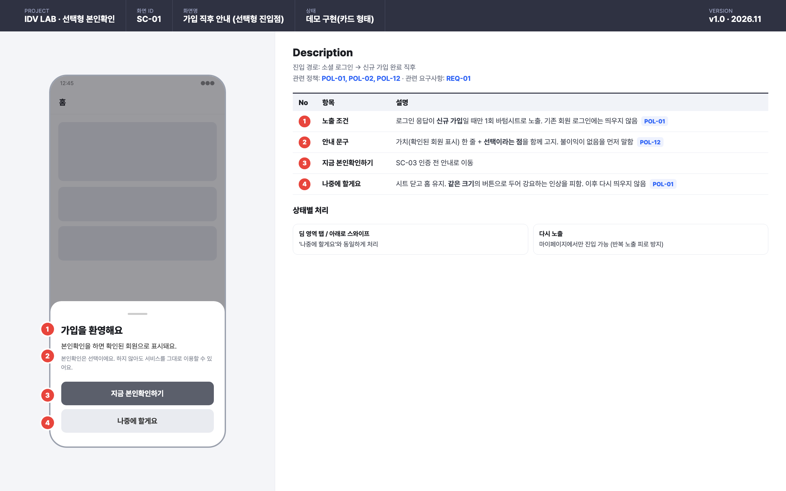
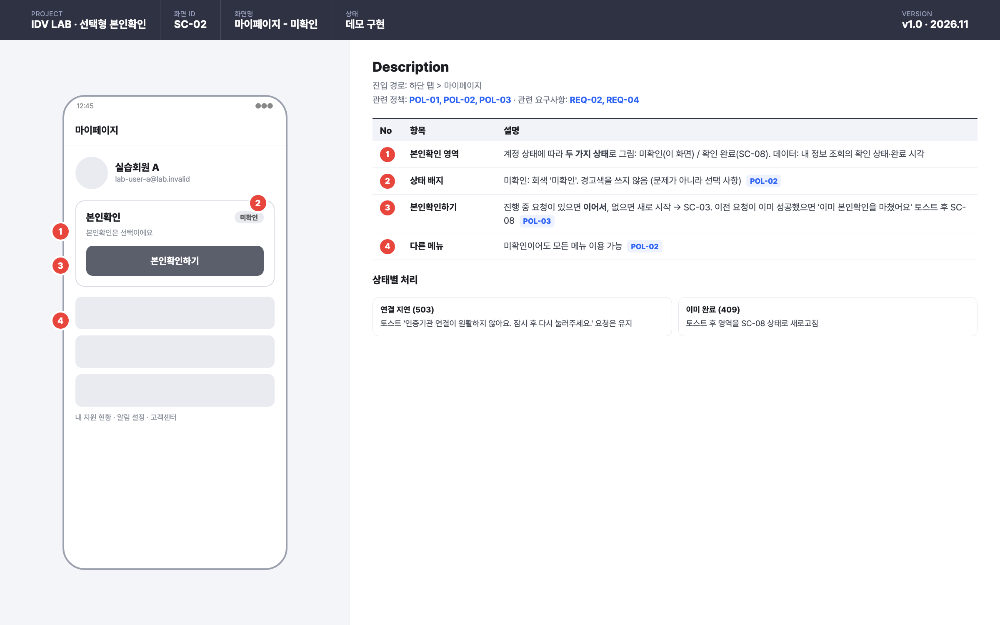
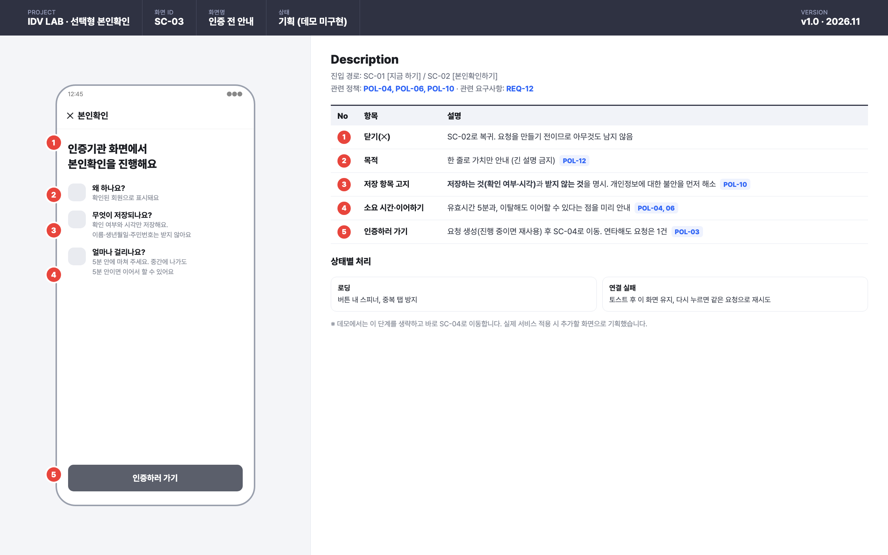
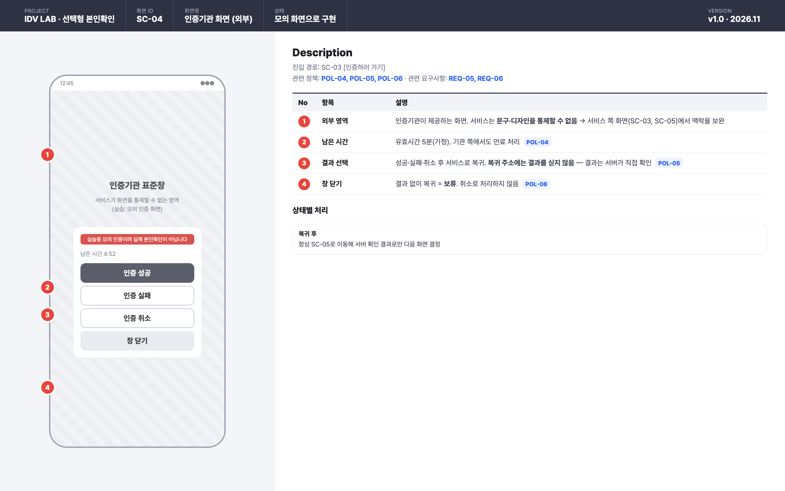
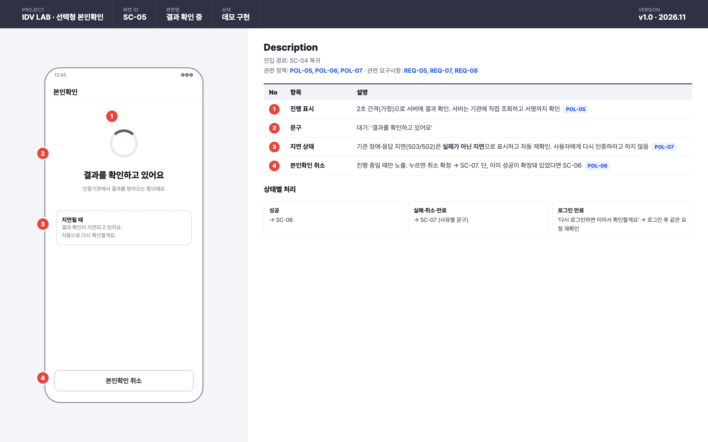
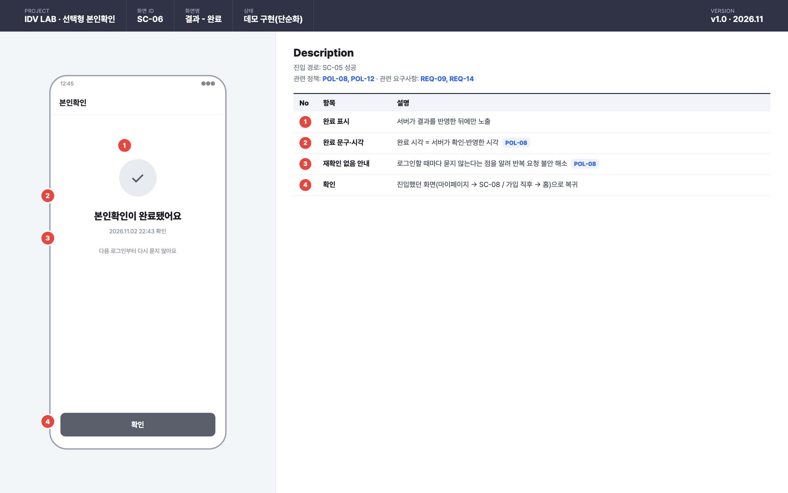
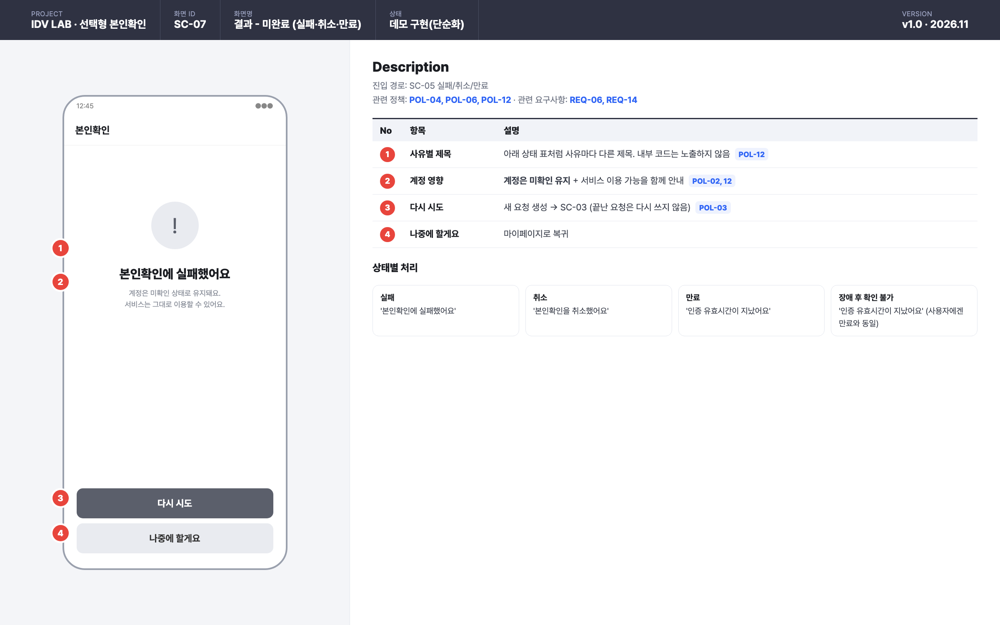
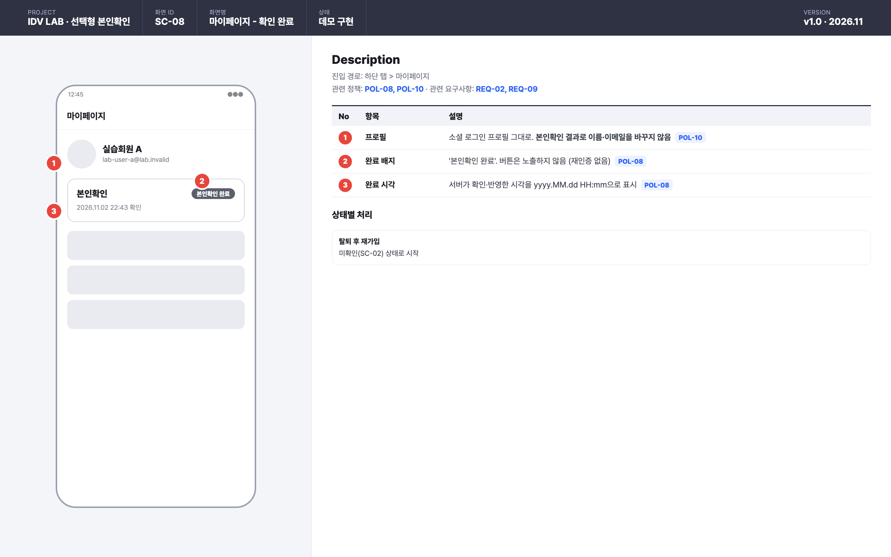

# 14. 화면설계서

> 화면 8개의 와이어프레임과 Description입니다. 화면마다 진입 경로, 관련 정책([12](12-policy-definition.md)), 요구사항([11](11-requirements.md)), 상태별 처리를 적었습니다.
> 원본은 [storyboard.html](storyboard/storyboard.html)이고, `lab/tools/render_storyboard.sh`로 이미지를 다시 만들 수 있습니다.
> 화면 순서와 분기는 [유저 플로우](13-user-flow.md)를 보세요.

## 화면 목록

| ID | 화면명 | 진입 경로 | 상태 |
|---|---|---|---|
| SC-01 | 가입 직후 안내 (선택형 진입점) | 신규 가입 직후 | 데모 구현(카드 형태) |
| SC-02 | 마이페이지 - 미확인 | 마이페이지 | 데모 구현 |
| SC-03 | 인증 전 안내 | SC-01, SC-02 | **기획** (데모 미구현) |
| SC-04 | 인증기관 화면 (외부) | SC-03 | 모의 화면으로 구현 |
| SC-05 | 결과 확인 중 | SC-04 복귀 | 데모 구현 |
| SC-06 | 결과 - 완료 | SC-05 | 데모 구현(단순화) |
| SC-07 | 결과 - 미완료 | SC-05 | 데모 구현(단순화) |
| SC-08 | 마이페이지 - 확인 완료 | 마이페이지 | 데모 구현 |

## SC-01 가입 직후 안내

## SC-02 마이페이지 - 미확인

## SC-03 인증 전 안내

## SC-04 인증기관 화면 (외부)

## SC-05 결과 확인 중

## SC-06 결과 - 완료

## SC-07 결과 - 미완료

## SC-08 마이페이지 - 확인 완료

## 공통: 응답 → 화면 매핑

앱 개발자에게 전달하는 분기 기준입니다.

| 상황 (API 응답) | 화면 | 문구 |
|---|---|---|
| 내 정보 `UNVERIFIED` | SC-02 | 본인확인하기 |
| 내 정보 `VERIFIED` | SC-08 | 본인확인 완료 · 완료 시각 |
| 요청 생성 201 / 200(이어하기) | SC-04 | (이동) |
| 요청 생성 409 | 토스트 → SC-08 | 이미 본인확인을 마쳤어요 |
| 요청 생성 503 | SC-02/SC-03 유지 + 토스트 | 인증기관 연결이 원활하지 않아요. 잠시 후 다시 눌러주세요 |
| 결과 `PENDING` | SC-05 | 결과를 확인하고 있어요 |
| 결과 503·502 | SC-05 (지연) | 결과 확인이 지연되고 있어요. 자동으로 다시 확인할게요 |
| 결과 `SUCCEEDED` | SC-06 | 본인확인이 완료됐어요 |
| 결과 `FAILED` | SC-07 | 본인확인에 실패했어요 |
| 결과 `CANCELLED` | SC-07 | 본인확인을 취소했어요 |
| 결과 `EXPIRED` | SC-07 | 인증 유효시간이 지났어요 |
| 401 | 로그인 | 다시 로그인하면 이어서 확인할게요 |
| 404 | SC-02 | 요청을 찾을 수 없어요 |

## 공통: 인터랙션 원칙

| 원칙 | 이유 | 정책 |
|---|---|---|
| 화면을 닫으면 아무것도 호출하지 않는다 (보류) | 실수로 닫아도 이어서 할 수 있게 | POL-06 |
| 취소 버튼은 진행 중일 때만 보인다 | 끝난 요청을 취소하려는 혼란 방지 | POL-06 |
| 요청 ID를 앱에 보관한다 | 복귀·재로그인 후에도 같은 요청을 확인 | POL-03 |
| 결과는 복귀 주소가 아니라 서버 확인으로 판단한다 | 앱이 보낸 값은 믿지 않는다 | POL-05 |
| 버튼은 결과가 올 때까지 중복 탭을 막는다 | 연타로 요청이 쌓이지 않게 (서버도 1건 보장) | POL-03 |
