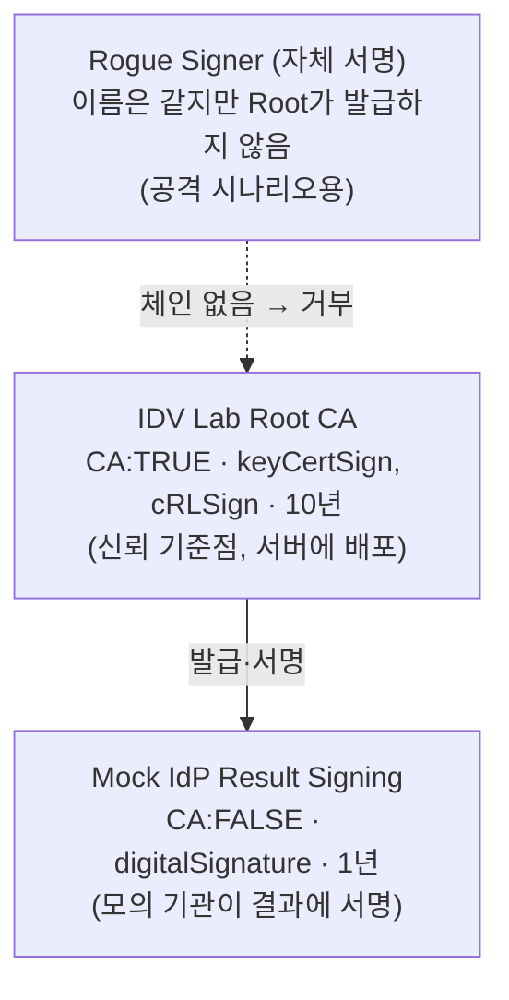
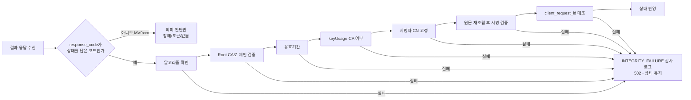

# 41. PKI와 인증서 체계 정리, 그리고 실습 구현

## 1. 기본 개념 (이 프로젝트에서 직접 다룬 범위)

| 개념 | 한 줄 정의 | 실습에서 해당하는 것 |
|---|---|---|
| 공개키·개인키 | 개인키로 서명하고, 공개키로 누구나 검증 | 모의 기관 결과 서명 키(RSA 2048) |
| 전자서명 | 원문의 해시를 개인키로 암호화한 값. 원문이 1비트만 바뀌어도 검증 실패 | `signed_data` (SHA256withRSA) |
| 인증서(X.509) | "이 공개키의 주인은 누구"라는 사실을 상위 기관(CA)이 서명해 보증하는 문서 | `mock-idp-signing.crt` |
| CA / Root CA | 인증서를 발급하는 기관. Root CA는 신뢰의 출발점(trust anchor) | `IDV Lab Root CA` |
| 체인 검증 | 서명자 인증서 → 발급자 → … → 신뢰하는 Root까지 서명을 따라가며 확인 | 이번 실습은 Root → 서명자 2단계 |
| 유효기간 | `notBefore`~`notAfter` 밖이면 무효 | Root 10년, 서명자 1년 (실습 가정) |
| 키 용도(keyUsage) | 인증서를 어디에 쓸 수 있는지 제한 (예: CA 서명용 vs 전자서명용) | Root는 keyCertSign, 서명자는 digitalSignature |
| 폐지 확인(CRL/OCSP) | 유효기간 안이라도 유출 등으로 폐지된 인증서를 걸러냄 | **범위 밖** |
| PKCS#7 / CMS | 서명값·인증서·원문을 한 봉투에 담는 표준 형식 | 범위 밖 (공개 가이드는 이 형식을 사용) |

## 2. 국내 인증서 체계 (배경 지식)

- **2020-12-10 전자서명법 전부개정 시행**으로 공인인증서·공인인증기관 제도가 폐지됐습니다.
  - 지금은 공인과 사설의 구분 없이 모든 전자서명의 효력이 같은 방향으로 바뀌었습니다.
  - 기존 공인인증서는 '공동인증서'라는 이름으로 계속 쓰입니다.
- 인증사업자가 되는 절차: 운영기준을 지키는지 **평가기관**에서 평가받고, **인정기관(KISA)**에서 준수사실을 인정받는 구조로 바뀌었습니다.
- 그 결과 금융권 인증서(금융인증서)와 민간 인증서(은행·핀테크·통신사 등)가 경쟁하는 구도가 됐습니다.
- 카카오뱅크 인증서 공개 페이지는 카카오뱅크가 다음을 갖췄다고 밝히고 있습니다.
  - 본인확인기관
  - 전자서명인증사업자
  - 웹트러스트(WebTrust) 라이선스
- WebTrust는 인증기관의 운영 통제를 외부 감사로 확인하는 국제 인증 체계입니다.

(출처와 주의사항은 [40-compliance-analysis.md §4](40-compliance-analysis.md#4-출처-검색-확인-2026-11-02) 참고)

## 3. 실습 PKI 구조

| 파일 | 생성 | 커밋 여부 |
|---|---|---|
| `lab/pki/generate-lab-pki.sh` | – | O (스크립트) |
| `lab/pki/out/*` (실행용 키·인증서) | `run-lab.sh`가 자동 생성 | **X** (`.gitignore`) |
| `src/test/resources/pki-test/*` (테스트 픽스처) | 같은 스크립트로 생성 | O (테스트 전용, Root 개인키는 제외) |

## 4. 결과 검증 흐름 (서버)

## 5. 검증 결과

| 시나리오 | 방법 | 결과 |
|---|---|---|
| 정상 서명 | U `valid`, E S1~S8 전체 | 통과 |
| 서명 후 상태 변조 (FAILED→SUCCEEDED) | U `tampered`, E S8 `TAMPER` | 502, **계정 미반영** |
| 같은 이름의 자체 서명 인증서 | U `untrustedIssuer`, E S8 `UNTRUSTED_SIGNER` | 502 |
| 인증서 만료 (시계를 2년 뒤로) | U `expiredCertificate` | 거부 |
| CA 인증서로 서명 시도 | U `caCertificateCannotSign` | 거부 |
| 약속되지 않은 서명자 | U `unexpectedSigner` | 거부 |
| 서명 누락·약한 알고리즘 | U `missingOrWrongAlgorithm` | 거부 |

## 6. 실제 서비스와의 차이

| 항목 | 실습 | 실제라면 |
|---|---|---|
| 개인키 보관 | 파일 | HSM 등 하드웨어 보안 모듈, 접근 통제와 이중 통제 |
| 서명 형식 | 원문·서명·인증서 분리 | PKCS#7/CMS, 필요하면 타임스탬프 |
| 폐지 확인 | 없음 | CRL 또는 OCSP 확인 |
| 체인 | 2단계 | Root → 중간 CA → 말단, 경로 검증(PKIX) |
| 인증서 교체 | 스크립트 재실행 | 사전 공지, 병행 기간, 포털 게시([21](21-partner-portal-plan.md) §5) |
| 운영 통제 | 없음 | 운영기준 준수 평가·인정, WebTrust 같은 외부 감사 |
